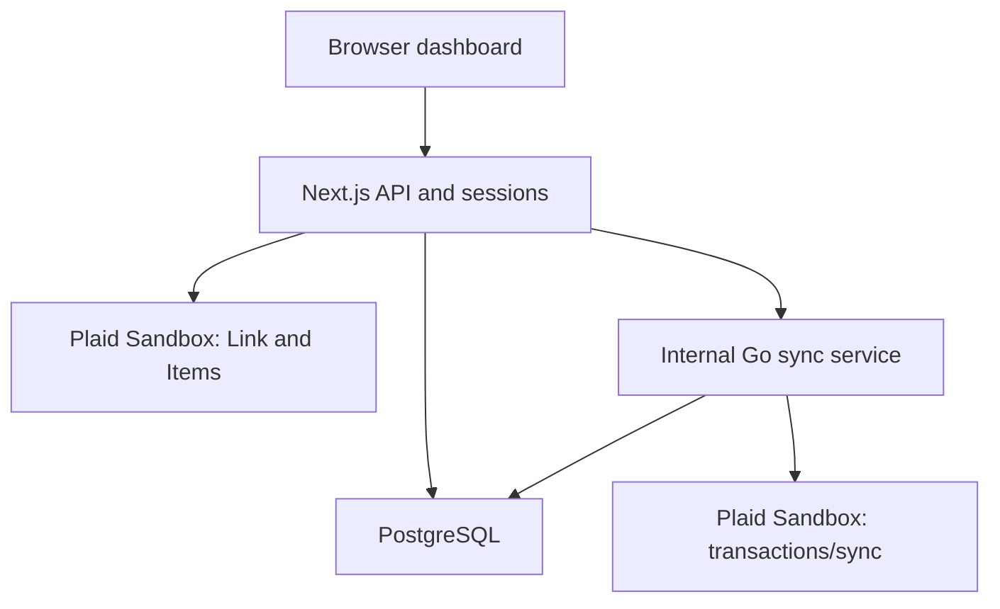

# Implemented architecture

## Processes and trust boundaries

The browser renders `apps/web/src/app/page.tsx`. Next.js serves the page and the same-origin `/api/*` backend. The single route entry point delegates to domain handlers in `src/lib/routes/`; `src/lib/api.ts` provides the authentication/error boundary. PostgreSQL stores relational state. The internal Go server accepts authenticated sync requests and talks to Plaid Sandbox. No message broker, cache cluster, service mesh or public deployment is required.

The browser sees public Link tokens, Item UUIDs, account metadata and its own financial records. Access tokens, the encryption key, password hashes, session digests, Plaid secret and service secret remain server-side. The Go service trusts the service bearer secret, but independently checks the supplied Item belongs to the supplied user. It is not a public user-authentication service. Compose exposes it only on the private container network.

## Schema

`database/migrations/001_initial.sql` is the authoritative DDL.

| Table | Role and important constraints |
| --- | --- |
| users | UUID identity, unique normalized email, password hash. No plaintext password column. |
| sessions | SHA-256 token digest as primary key, user FK, absolute expiration. User/expiry indexes support lookup and future cleanup. |
| auth_attempts | Persistent per-normalized-email hash bucket. Atomic upsert counts requests in a 15-minute window; attempts beyond 10 return 429. |
| categories | Fixed shared category IDs. User overrides reference valid IDs. |
| plaid_items | One unique provider Item ID, owner, encrypted access token, institution label, lifecycle status. Active Items require a stored token. |
| sync_state | One-to-one Item FK; opaque cursor, last committed sync time and safe error code. |
| accounts | Owner; nullable Item/provider-account IDs for manual accounts; unique `(item_id, plaid_account_id)`. Currency and provider metadata. |
| transactions | Account, owner and optional Item/provider ID. Numeric amount, date, source, pending flag, tombstone, prediction and override. Unique `(item_id, plaid_transaction_id)` and `(user_id, import_key)`. |
| budgets | Positive numeric target by owner, category, first-of-month date and currency; that tuple is unique. |
| schema_migrations | Runner-created table recording migration filename, checksum and timestamp. |

Composite foreign keys tie `transactions(account_id,user_id)` to `accounts(id,user_id)` and linked transaction Item/account/owner combinations to their parent rows. They reject accidental cross-user or cross-Item associations even if a future caller misses an application check. Private SELECT/UPDATE queries still need owner predicates: foreign keys do not filter reads, and PostgreSQL row-level security is not enabled.

Transactions have a partial owner/date/ID index for stable ordered retrieval of nonremoved rows. Account and Item owner indexes support dashboard lookups. Unique indexes enforce deduplication under concurrency rather than relying on a pre-insert check. Budget uniqueness supports one-statement upserts. No benchmark-derived index-performance claims are made.

Amounts are `numeric(18,2)` and returned as decimal strings. Application-entered amounts allow up to 12 integer digits and two decimals. Go parses provider amounts as exact rational decimal values before sign inversion, rejecting excessive fractional precision. Only CAD/USD are currently accepted by application operations; the schema permits three-letter codes for future expansion. Summaries group by currency instead of summing unlike units.

## Transaction boundaries

| Operation | Atomic unit | Network calls inside boundary? |
| --- | --- | --- |
| Migration | All unapplied ordered migration SQL and version records under one advisory lock | No |
| Registration | Insert user + default manual account | No; password derivation precedes BEGIN. Session creation is a separate awaited insert. |
| Login | Session insert after credentials verified | No |
| Plaid connection | Item + initial account metadata + empty sync state | Exchange/metadata fetched first; compensate with Item removal if persistence fails. Compensation is best effort. |
| CSV import | Every new row, duplicate-content checks, and entire-file conflict outcome | No |
| Manual entry | Ownership/category checks + insert | No |
| Go sync | Item lock, persisted cursor read, fetch pages, all account/transaction changes + cursor and last_synced_at | Yes; deliberately simple, bounded to 90 seconds by request context. |
| Disconnect intent | Take same Item advisory lock, mark disconnecting | No |
| Disconnect completion | Mark disconnected, erase token, deactivate accounts | Provider revocation happens between the two DB transactions. |

A successful Plaid response does not imply a successful commit. Go returns success only after `tx.Commit()` succeeds. If connection loss makes the commit outcome uncertain, the caller gets an error and retries: a committed cursor prevents re-fetching old pages, while provider uniqueness protects a replay. This is at-least-once processing with idempotent storage, not an exactly-once network protocol.

## Synchronization algorithm

`internal/syncer/store.go` starts a transaction, takes `pg_try_advisory_xact_lock(hashtextextended(item_id,0))`, and verifies an active owned Item with row locks on Item/sync state. A competing sync returns ErrBusy/HTTP 409. Locks release on COMMIT, ROLLBACK or connection termination. Hash collisions would serialize unrelated Items, not corrupt data.

`plaid.go:Collect` temporarily retains the original committed cursor, fetches pages using each next_cursor and accumulates changes. On `TRANSACTIONS_SYNC_MUTATION_DURING_PAGINATION`, the entire attempt is discarded and fetch restarts at the original cursor. There are at most three complete attempts; transient failures retry the same cursor at most four times per page with 100/200/400 ms pauses. Context cancellation interrupts pauses. HTTP 429, server errors, transport errors and PRODUCT_NOT_READY qualify; permanent failures return immediately. Cycle detection, a 100-page bound and an 8 MiB per-response bound prevent unbounded pagination.

Only after the final page does the service apply changes in page order: account upserts, added/modified transaction upserts, then removals. Missing accounts, currency mismatches, invalid data or any SQL error abort the batch. Updates preserve `category_override_id`. Removals set `removed_at`; a later upsert clears it. Finally cursor, sync timestamp and error clearing commit together. Counts report provider change events processed, not necessarily new database rows.

An empty valid response can still advance a cursor. A final response may legitimately return the same cursor when there are no changes. This is allowed; a repeated cursor while `has_more=true` is rejected.

## Disconnect and cross-system consistency

Disconnect first records `disconnecting` while holding the same lock used by sync. It releases the transaction, revokes the token at Plaid, then clears the local token and marks accounts inactive. A provider failure leaves the Item disconnecting so the user can retry; new syncs reject it. A process crash after remote revocation but before local completion is an unresolved distributed boundary: reconciling a provider's already-invalid token may require operational investigation. The implementation does not falsely promise atomicity between Plaid and PostgreSQL. Historical records are retained.

Likewise, exchange and local persistence cannot be one distributed ACID transaction. On failure, removal is attempted but not guaranteed if the provider/network also fails. A durable outbox/token-revocation retry queue is an explicit future improvement, not implemented infrastructure.

## Classification path

Training is an explicit script. Node imports `packages/classifier/model.json`; Go embeds the generated identical artifact in its binary. Both lowercase ASCII words, ignore unknown vocabulary, add smoothed log likelihoods plus the class prior, and choose the highest score with stable category ordering. With no known words they return Other. The training command writes both artifacts; tests check they match.

Manual and CSV insertions run inference in Node. Provider additions/modifications run it in Go. Effective category is `COALESCE(category_override_id,predicted_category_id)`. Clearing an override reveals the latest prediction. Overrides neither retrain nor overwrite the model. Existing predictions are not automatically recomputed after retraining; modified provider transactions are recomputed when synced.

## Operational scope

No scheduler/webhook or automatic sync on connection is implemented. Manual Sync invokes the real incremental path and safely handles initial empty results. Current balances are metadata; no on-demand balance endpoint or available-funds claim exists. Shared database credentials simplify local development but are not a production least-privilege role design. See security/verification documents before describing the project as production-ready.
